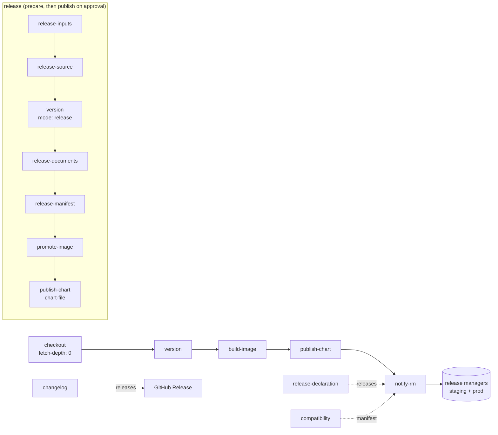

# wire-rm-actions

[](LICENSE)

**Shared GitHub Actions for the components the Wire release manager tracks.**
One version per build, one chart layout, one way to tell the release manager
what was built.



## The actions

| | Action | What it does |
|---|---|---|
| 🏷️ | [**version**](version/README.md) | The version of the commit: the tag on a tag build, else a dev build derived from the nearest release tag (`5.2.2-20260930120000.gabcdef0`); in release mode, the next release version of a branch (`5.2.2`, `5.3.0-rc.1`). |
| 🐳 | [**build-image**](build-image/README.md) | Builds a Dockerfile with BuildKit and pushes the image at that version with its provenance and SBOM attestations, never overwriting a pushed tag; outputs the registry digest. |
| 🔐 | [**quay-login**](quay-login/README.md) | Logs in to quay.io with the job's OIDC token through a federated robot account: no robot password to store or rotate. |
| 📦 | [**publish-chart**](publish-chart/README.md) | Packages the Helm chart at that version (`version == appVersion`), or pushes a packaged `.tgz` as is, to `oci://quay.io/wire/charts/<channel>/<name>`, never overwriting a published version. |
| 📣 | [**notify-rm**](notify-rm/README.md) | Declares the version, its artifact and its provenance to the staging and prod release managers. |
| 📝 | [**changelog**](changelog/README.md) | Writes the changelog since the previous release tag from conventional commits, in the generate-changelog release format. |
| ✅ | [**release-declaration**](release-declaration/README.md) | Validates a release declaration (what a version changes for an operator) against the schema of this repository. |
| 📄 | [**release-documents**](release-documents/README.md) | Gathers the release note and the release declaration of a release or a dev build, and the `documents` object of its manifest. |
| 🧾 | [**release-manifest**](release-manifest/README.md) | Writes, verifies and completes the release manifest: the build, its artifacts by digest and its `compatibility` (provides, requires, includes). |
| 🧩 | [**compatibility**](compatibility/README.md) | Checks the compatibility file (what a component provides, consumes, depends on and includes) and writes it for the release manifest. |
| 🎛️ | [**release-inputs**](release-inputs/README.md) | Validates the dispatch inputs of a prepare-release or publish-release workflow (branch, type, bump, version, release manager request, size budget) before anything runs. |
| 🌿 | [**release-source**](release-source/README.md) | The source of a candidate: checks the branch exists, records the commit the checkout is at, and writes the identity of the candidate (version, channel, commits since the previous release) to the job summary. |
| 🚀 | [**promote-image**](promote-image/README.md) | Gives the candidate image its release tag by digest, without any rebuild; idempotent, never overwrites. |
| 🚦 | [**ci-gate**](ci-gate/README.md) | Refuses a release preparation when a release or tag already exists for the version, or when the CI checks of the source commit did not pass (`force` bypass, logged). |
| 🗂️ | [**draft-release**](draft-release/README.md) | Creates the draft GitHub Release of a candidate with its assets, resolves and downloads it at publication, and publishes it last (the tag is born there). |
| 🪣 | [**publish-chart-s3**](publish-chart-s3/README.md) | Interim: pushes a packaged chart to an S3 Helm repository (helm-s3) for the deployments that still read one, never overwriting a published version. |

Each action has its own page: definition, inputs and outputs, a copy-paste
example, and the reasons behind its design.

## Quick start

A dev build of a component with images and a chart. Replace `<sha>` with the
commit of a release tag ([Pin a release](#pin-a-release)).

```yaml
name: Dev build

on:
  push:
    branches: [dev]

permissions: {}

concurrency:
  group: ${{ github.workflow }}-${{ github.ref }}
  cancel-in-progress: false # never stop a publication halfway

jobs:
  dev-build:
    runs-on: ubuntu-latest
    permissions:
      contents: read
    steps:
      - uses: actions/checkout@3d3c42e5aac5ba805825da76410c181273ba90b1 # v7.0.1
        with:
          fetch-depth: 0
          persist-credentials: false
      - id: version
        uses: wireapp/wire-rm-actions/version@<sha> # vX.Y.Z
      # The images before the chart: the chart must never point at a missing image.
      - uses: wireapp/wire-rm-actions/build-image@<sha> # vX.Y.Z
        with:
          dockerfile: docker/Dockerfile
          image: quay.io/wire/my-component
          version: ${{ steps.version.outputs.version }}
          expires-after: 90d
          username: ${{ secrets.QUAY_USER }}
          password: ${{ secrets.QUAY_TOKEN }}
      - uses: azure/setup-helm@9bc31f4ebc9c6b171d7bfbaa5d006ae7abdb4310 # v5.0.1
        with:
          version: v4.3.0
      - id: chart
        uses: wireapp/wire-rm-actions/publish-chart@<sha> # vX.Y.Z
        with:
          chart-path: charts/my-chart
          version: ${{ steps.version.outputs.version }}
          username: ${{ secrets.QUAY_USER }}
          password: ${{ secrets.QUAY_TOKEN }}
      - uses: wireapp/wire-rm-actions/notify-rm@<sha> # vX.Y.Z
        with:
          rm-staging-url: ${{ secrets.RM_STAGING_URL }}
          rm-staging-token: ${{ secrets.RM_STAGING_TOKEN }}
          rm-prod-url: ${{ secrets.RM_PROD_URL }}
          rm-prod-token: ${{ secrets.RM_PROD_TOKEN }}
          component: my-component
          version: ${{ steps.version.outputs.version }}
          kind: ${{ steps.version.outputs.kind }}
          repository: ${{ steps.chart.outputs.repository }}
          digest: ${{ steps.chart.outputs.digest }}
```

The chart defaults its image tag to `.Chart.AppVersion` (or `.Chart.Version`):
both equal the version, so the chart always pulls the image of its own build.

A release pipeline (ADR-0021) prepares a candidate, then publishes it once a
release manager approves. [release-inputs](release-inputs/README.md) validates
the dispatch inputs and [ci-gate](ci-gate/README.md) gates the preparation;
then [version](version/README.md) in release mode, the
[changelog](changelog/README.md), the
[release declaration](release-declaration/README.md), the
[release documents](release-documents/README.md) and the
[release manifest](release-manifest/README.md) go into a
[draft release](draft-release/README.md). Publication verifies the manifest,
runs [promote-image](promote-image/README.md),
[publish-chart](publish-chart/README.md) with `chart-file`, completes the
manifest, declares it with [notify-rm](notify-rm/README.md) (with the
`release-declaration-file` input) and ends with the publication of the draft
GitHub Release, which creates the tag.

## Reusable workflow

A chart-only component can call the whole dev build in one job:
[`.github/workflows/dev-build.yml`](.github/workflows/dev-build.yml) runs
`version`, `quay-login`, `publish-chart` and `notify-rm` from the same
release, with the OIDC token of the job as its only credential.

```yaml
name: Dev build

on:
  push:
    branches: [dev]

permissions: {}

concurrency:
  group: ${{ github.workflow }}-${{ github.ref }}
  cancel-in-progress: false # never stop a publication halfway

jobs:
  dev-build:
    permissions:
      contents: read
      id-token: write
    uses: wireapp/wire-rm-actions/.github/workflows/dev-build.yml@<sha> # vX.Y.Z
    with:
      component: my-component
      chart-path: charts/my-chart
      quay-robot: wire+gha_my-component
```

| Input | Default | |
|---|---|---|
| `component` | required | Release manager component id. |
| `chart-path` | required | Path of the chart directory. |
| `chart-name` | the `Chart.yaml` name | Chart name in the registry. |
| `quay-robot` | required | Federated robot account of the team, with a federation entry for the job's subject ([quay-login](quay-login/README.md)). |
| `release-branches` | `^(dev\|develop\|release/.+\|release-.+)$` | Branches without a `<branch>` identifier in their versions. |
| `registry` | `quay.io` | OCI registry host. |
| `rm-staging-url`, `rm-prod-url` | the `RM_STAGING_URL`, `RM_PROD_URL` variables | Release manager URLs. Variables are printed in the step log: in a public component, call [notify-rm](notify-rm/README.md) with secrets instead. |
| `rm-staging-audience`, `rm-prod-audience` | `wire-release-manager-staging`, `wire-release-manager-prod` | OIDC audiences of the release managers ([notify-rm](notify-rm/README.md#oidc-mode-no-token-to-store)). |
| `rm-required` | `false` | Fail the job when a declaration fails. |

No secrets: the job's OIDC token is exchanged for a one-hour quay robot token
and sent to the release managers. Outputs: `version` and `digest`. A tag build
publishes to the `stable` channel, any other build to `dev`.

## Pin a release

Consume a release, never a branch: pin the full commit SHA of a `vX.Y.Z` tag,
with the tag in a comment, and let Dependabot (`github-actions` ecosystem)
propose the next release.

```yaml
uses: wireapp/wire-rm-actions/version@<sha> # vX.Y.Z
```

- Take the SHA of the commit the tag points to, from the Releases page or with
  `git rev-parse vX.Y.Z^{commit}`.
- All the actions of a run come from the same release.
- The reusable workflow is pinned the same way, and each release points its
  actions at its own tag.
- Release tags are signed, cannot be moved or deleted, and published releases
  are immutable.

## Security

- Secrets reach a step through `env:` or stdin only, never a command line or a
  `${{ }}` expression inside `run:`.
- Every third-party action is pinned by SHA; the tools of the CI are pinned
  with their sha256.
- Report a vulnerability privately: [SECURITY.md](SECURITY.md).

## Development

```bash
make tools   # pinned shellcheck, actionlint, gitleaks, helm, zizmor, pytest
make ci      # lint, audit, tests, secrets scan, commit message rules
```

- Contribution rules and release procedure: [CONTRIBUTING.md](CONTRIBUTING.md).

## License

Copyright 2026 Wire Swiss GmbH. Licensed under the
[Apache License, Version 2.0](LICENSE).
